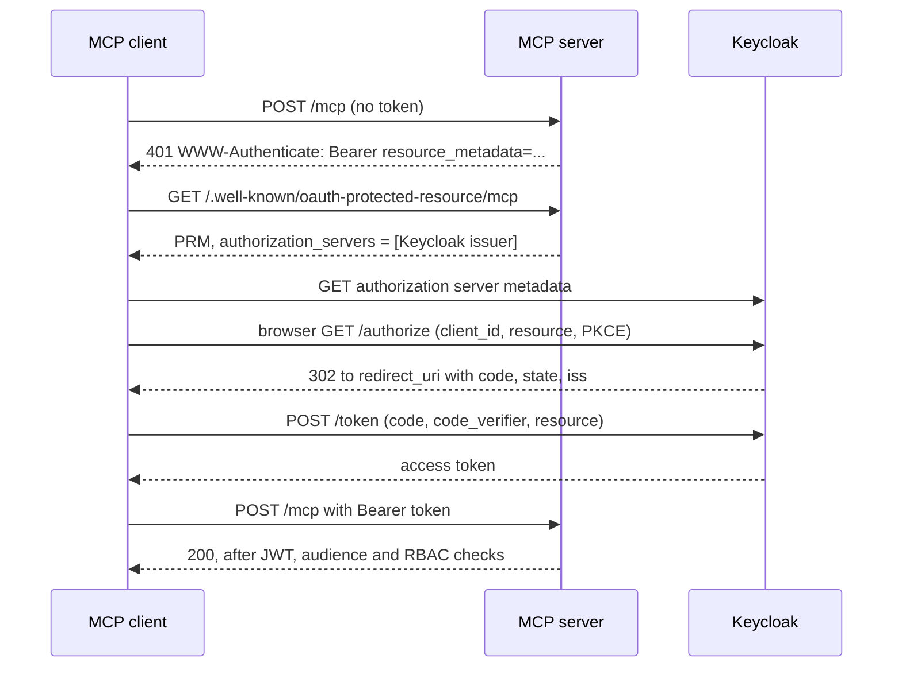
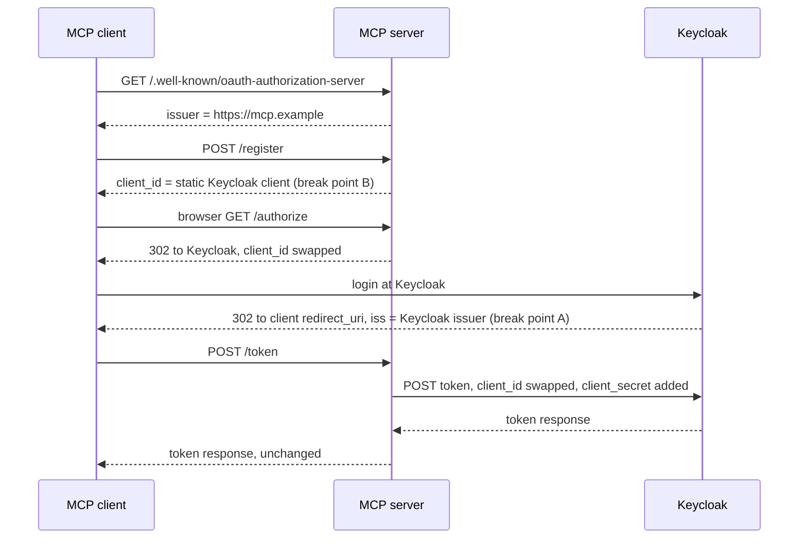
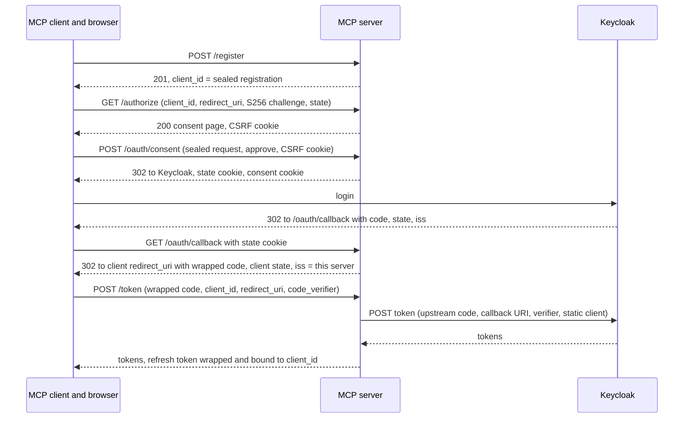

# OAuth proxy modes, flows and Keycloak settings

This guide explains the three ways an `rmcp-server-kit` server can sit in an
OAuth 2.1 deployment, what happens on the wire in each of them, which knobs
control them, and what to set in Keycloak for each. It describes what the
current build does. Where the original design intent and the shipped
behaviour differ, the text says so.

It assumes you already know the basics from the guide:
[`OAuthConfig`](GUIDE.md#oauthconfig),
[`OAuthProxyConfig`](GUIDE.md#oauthproxyconfig-optional),
[OAuth discovery metadata](GUIDE.md#oauth-discovery-metadata-rfc-9728--rfc-8414),
the [TOML reference](GUIDE.md#complete-toml-configuration-reference) and the
[environment variable overrides](GUIDE.md#environment-variable-overrides-opt-in).
A runnable demo lives in
[`examples/oauth_proxy_as_demo.rs`](../examples/oauth_proxy_as_demo.rs).

Placeholders used throughout: this MCP server is reachable at
`https://mcp.example`, the Keycloak realm issuer is
`https://idp.example/realms/example`, and the static Keycloak client is
`mcp-example`. Every secret shown is a placeholder.

**What is proven and what is not.** The crate's own tests drive every flow
below against a real listener, with a `wiremock` stand-in for the identity
provider, and they pin acceptance of access tokens shaped like the ones a
Keycloak 26.6 realm issues (ES384 signature, `typ: at+jwt`, array `aud`,
`realm_access` / `resource_access` / `groups` role claims). A real MCP client
completing any of these flows against a live Keycloak has **not** been
verified by this work. Treat the Keycloak sections as a checklist to test in
your own environment, not as a tested recipe.

## 1. Which mode do I need?

| | Direct mode (no proxy) | Passthrough proxy | `authorization_server` proxy |
|---|---|---|---|
| Configured by | no `[server.auth.oauth.proxy]` table | `[server.auth.oauth.proxy]` without `mode`, or `mode = "passthrough"` (the default) | `[server.auth.oauth.proxy]` with `mode = "authorization_server"` |
| Who the client talks to for login | Keycloak directly | this server for `/register`, `/authorize`, `/token`; Keycloak redirects the browser straight back to the client | this server for every OAuth step; Keycloak only ever redirects to this server's `/oauth/callback` |
| Consent owner | Keycloak | nobody per client (Keycloak sees one shared static client) | this server shows a per-client consent page; Keycloak may show its own too |
| `iss` on the authorization response with Keycloak 23 or later | Keycloak's issuer, which matches the metadata the client read from Keycloak | Keycloak's issuer, which does **not** match this server's AS metadata `issuer` | this server's issuer, re-stamped at `/oauth/callback`, which matches its AS metadata |
| MCP 2026-07-28 client compatibility | yes, if Keycloak supports the client's registration method (CIMD, see section 8) | **no**: issuer mismatch, and no per-client consent | designed for it; not verified against a live Keycloak |
| Keycloak redirect URIs needed | each client's own redirect URIs (CIMD or registration handles them) | every redirect URI any client may use, on the one static client | exactly one: `https://mcp.example/oauth/callback` |
| State and secrets this server needs | none beyond the OAuth settings | the static client id (and secret, if confidential) | the static client id (and secret), plus `sealing_secret`, shared by every replica |
| Choose it when | the IdP supports what MCP clients need (for Keycloak: CIMD and resource indicators) | you must keep the 3.20.0 behaviour, or the IdP cannot do dynamic registration and clients do not check `iss` (for example Microsoft Entra ID without DCR, with `strip_resource_param = true`) | the IdP has no client registration MCP clients can use, and you need 2026-07-28 clients to work through one static client |

The passthrough proxy stays the default only for backward compatibility. An
unchanged 3.20.0 configuration keeps its 3.20.0 wire behaviour byte for byte.

## 2. Flow dissection: direct mode

No proxy table is configured. This server is only a resource server: it
publishes Protected Resource Metadata (PRM), answers unauthenticated requests
with a `401` challenge, and validates JWTs. Keycloak does everything else.

```text
MCP client                    MCP server (https://mcp.example)       Keycloak
    |  POST /mcp (no token)            |                                 |
    |--------------------------------->|                                 |
    |  401 WWW-Authenticate: Bearer    |                                 |
    |  resource_metadata=".../mcp"     |                                 |
    |<---------------------------------|                                 |
    |  GET /.well-known/oauth-protected-resource/mcp                     |
    |--------------------------------->|                                 |
    |  { resource, authorization_servers: [Keycloak issuer] }            |
    |<---------------------------------|                                 |
    |  GET Keycloak metadata ------------------------------------------->|
    |  browser: GET /authorize (client_id, resource, PKCE) ------------->|
    |  browser <= 302 redirect_uri?code&state&iss=<Keycloak issuer> -----|
    |  POST /token (code, code_verifier, resource) --------------------->|
    |  <= access_token ---------------------------------------------------|
    |  POST /mcp  Authorization: Bearer <JWT>                            |
    |--------------------------------->| verify signature (JWKS),        |
    |                                  | iss, aud, exp, role, RBAC       |
    |  200 MCP response                |                                 |
    |<---------------------------------|                                 |
```



| Step | Actor | HTTP request | Validated, and by whom |
|---|---|---|---|
| 1 | client | `POST /mcp` without credentials | this server answers `401` with `WWW-Authenticate: Bearer resource_metadata="https://mcp.example/.well-known/oauth-protected-resource/mcp"`, then the optional `scope="..."` from `challenge_scopes`, then `error="invalid_request", error_description=...` unless `omit_error_on_missing_credential = true` |
| 2 | client | `GET /.well-known/oauth-protected-resource/mcp` (the root path `/.well-known/oauth-protected-resource` serves the same document) | none; the document carries `resource = "https://mcp.example/mcp"`, `authorization_servers = ["https://idp.example/realms/example"]`, `bearer_methods_supported` and, when scope mappings exist, `scopes_supported` |
| 3 | client | Keycloak authorization server metadata | the client checks the metadata `issuer` against the issuer it asked for |
| 4 | browser | `GET` Keycloak authorize endpoint with `client_id`, `redirect_uri`, `resource`, `code_challenge` (S256), `state` | Keycloak: client identity (CIMD or registration), redirect URI, PKCE method, login, its own consent |
| 5 | Keycloak | `302` to the client's `redirect_uri` with `code`, `state`, `iss` | the client checks `state` and that `iss` equals the issuer from step 3 (RFC 9207) |
| 6 | client | `POST` Keycloak token endpoint with `code`, `code_verifier`, `resource` | Keycloak: code, PKCE verifier, resource |
| 7 | client | `POST /mcp` with `Authorization: Bearer <JWT>` | this server: signature against the JWKS, `iss` equal to `oauth.issuer`, `aud` containing `oauth.audience`, an `additional_audiences` entry, or (with `accept_resource_audience = true`) `https://mcp.example/mcp`; expiry; role resolution; then RBAC per tool call |

`aud` is checked here, at step 7, by this server. `iss` is checked twice: by
the client on the authorization response (step 5) and by this server on the
JWT (step 7). Without `public_url` the server logs a startup WARN and the
challenge carries the relative `resource_metadata="/.well-known/oauth-protected-resource"`.

## 3. Flow dissection: passthrough proxy

The proxy table exists and `mode` is absent or `"passthrough"`. This server
mounts `/.well-known/oauth-authorization-server`, `/register`, `/authorize`
and `/token` (plus `/introspect` and `/revoke` when exposed) and swaps the
client id on the way through. It keeps no state.

```text
MCP client                    MCP server (https://mcp.example)       Keycloak
    |  401 -> PRM: authorization_servers = ["https://mcp.example"]       |
    |  GET /.well-known/oauth-authorization-server                       |
    |--------------------------------->|                                 |
    |  { issuer: "https://mcp.example", ... }                            |
    |<---------------------------------|                                 |
    |  POST /register                  |                                 |
    |--------------------------------->|                                 |
    |  { client_id: "mcp-example" }  (B) shared static client, no consent|
    |<---------------------------------|                                 |
    |  browser GET /authorize          |                                 |
    |--------------------------------->|                                 |
    |  302 to Keycloak, client_id swapped, everything else forwarded     |
    |<---------------------------------|                                 |
    |  browser -> Keycloak login --------------------------------------->|
    |  (A) 302 straight to the client: code, state,                      |
    |      iss=https://idp.example/realms/example <---------------------|
    |  client compares iss with "https://mcp.example" => mismatch, abort |
    |  POST /token (only if the client did not abort)                    |
    |--------------------------------->| client_id swapped, secret added |
    |                                  |-------------------------------->|
    |  <= upstream token response, relayed unchanged <--------------------|
```



| Step | Actor | HTTP request | Validated, and by whom |
|---|---|---|---|
| 1 | client | `POST /mcp`, then PRM | as in direct mode, but PRM `authorization_servers` is `["https://mcp.example"]` |
| 2 | client | `GET /.well-known/oauth-authorization-server` | none; `issuer` is this server's URL, endpoints point at this server, `token_endpoint_auth_methods_supported = ["none"]` |
| 3 | client | `POST /register` | nothing: the response is `200` with the static `client_id`, `token_endpoint_auth_method = "none"`, and the request's `redirect_uris` / `client_name` echoed back |
| 4 | browser | `GET /authorize?...` | this server only rewrites `client_id` (and drops `resource` when `strip_resource_param = true`) and answers `302` to `proxy.authorize_url` |
| 5 | Keycloak | `302` to the client's `redirect_uri` with `code`, `state`, `iss` | Keycloak checked the redirect URI against the static client; the client checks `iss` |
| 6 | client | `POST /token` | this server rewrites `client_id`, appends `client_secret` when configured, and relays the upstream response with its status |
| 7 | client | `POST /mcp` with the JWT | as in direct mode |

**Break point A.** The upstream redirect bypasses this server. Keycloak 23 and
later stamp `iss=<Keycloak issuer>` on it (source: Keycloak upgrading guide,
"Migrating to 23.0.0", *Added iss parameter to OAuth 2.0/OpenID Connect
Authentication Response*). A client that follows RFC 9207, as MCP 2026-07-28
clients do, compares that value with the `issuer` of the metadata it used,
which is `https://mcp.example`, and aborts.

**Break point B.** `/register` hands every client the same static client id.
Keycloak cannot tell one MCP client from another, and this server shows no
consent page. The MCP Security Best Practices for 2026-07-28 say MCP proxy
servers "MUST implement per-client consent" against this confused-deputy
attack ([MCP Security Best Practices](https://modelcontextprotocol.io/specification/2026-07-28/basic/security_best_practices)).

**Passthrough is therefore not MCP 2026-07-28 conformant.** It remains the
default only so that existing deployments keep working after an upgrade. No
startup warning is logged for it.

Existing workarounds, each with a cost:

- `authorization_server_metadata_issuer = "https://idp.example/realms/example"`
  makes the AS metadata claim Keycloak's issuer, so `iss` matches. It breaks
  RFC 8414 section 3.3: the document is served from `https://mcp.example`, and
  a client that checks the metadata `issuer` against the URL it fetched it
  from rejects it.

```toml,fragment
[server.auth.oauth]
authorization_server_metadata_issuer = "https://idp.example/realms/example"
```

- Keycloak's per-client switch **Exclude Issuer From Authentication Response**
  stops Keycloak from adding `iss` (source: Keycloak upgrading guide,
  "Migrating to 23.0.0"). Keycloak lists it as deprecated, to be removed in a
  future version (source: Keycloak upgrading guide, "Migrating to 26.8.0",
  Deprecated features). What a client does when `iss` is missing is up to
  that client.
- Keep the static client's **Valid Redirect URIs** to loopback patterns only
  (for example `http://127.0.0.1/*` and `http://localhost/*`), so the shared
  client can at least not be sent to an arbitrary web host.

## 4. Flow dissection: `authorization_server` proxy

With `mode = "authorization_server"` this server becomes the authorization
server MCP clients see. It registers clients itself, shows its own consent
page, receives Keycloak's redirect at `/oauth/callback`, and only then sends
the browser back to the client. Keycloak sees one static client with one
redirect URI.

**Stateless design.** Nothing is stored on the server. Client registrations,
the pending consent request, the per-flow state, the wrapped authorization
code, remembered consent and wrapped refresh tokens are all *sealed*: a JSON
payload plus an HMAC-SHA256 tag keyed from `sealing_secret`, with a separate
key per purpose. Sealing protects **integrity, not confidentiality**. The
payload is base64url JSON that anyone holding the value can read. In
particular a client can read the upstream refresh token (`rt`) inside the
refresh wrapper it receives; hiding the upstream refresh token from the client
it was issued for is not a goal. Sealed values are capped at 8192 bytes.

```text
MCP client / browser          MCP server (https://mcp.example)       Keycloak
 1 POST /register  ------------->| seal {redirect_uris, name}         |
   <- 201 client_id=<sealed>     |                                    |
 2 GET /authorize?client_id&redirect_uri&code_challenge&state&scope   |
   ----------------------------->| open client, exact redirect_uri,   |
                                 | S256 PKCE, scopes, resources       |
   <- 200 consent page + CSRF cookie (10 min)                         |
 3 POST /oauth/consent request=<sealed>&decision=approve + CSRF cookie |
   ----------------------------->| open request, check expiry + CSRF  |
   <- 302 to Keycloak + state cookie (10 min) + consent cookie        |
      client_id=mcp-example, redirect_uri=https://mcp.example/oauth/callback,
      state=<new random nonce>, code_challenge=<client's challenge>   |
 4 browser -> Keycloak login ---------------------------------------->|
   <- 302 https://mcp.example/oauth/callback?code&state&iss ----------|
 5 GET /oauth/callback ---------->| state cookie by nonce digest, open |
                                 | it, iss == oauth.issuer (bytes)    |
   <- 302 client redirect_uri?code=<wrapped>&state=<client state>&iss=https://mcp.example
      (state cookie cleared)     |                                    |
 6 POST /token code=<wrapped>&client_id&redirect_uri&code_verifier    |
   ----------------------------->| open code: client, redirect_uri,   |
                                 | PKCE, 120 s => allowlisted form  ->|
   <- tokens, refresh_token=<wrapped, bound to client_id> <-----------|
 7 POST /mcp Authorization: Bearer <JWT>  (as in direct mode)         |
```



| Step | Actor | HTTP request | Validated, and by whom |
|---|---|---|---|
| 1 | client | `POST /register` with `redirect_uris` and optional `client_name` | this server: 1 to 5 redirect URIs, at most 512 bytes each and 2048 in total; each must be `https` with a host, or `http` on `127.0.0.1`, `[::1]` or `localhost`; no fragment, userinfo, backslash or control character. `client_name` at most 128 characters, no control characters, and none of the invisible or bidirectional format characters, which are the Unicode `Default_Ignorable_Code_Point` set except the variation selectors U+FE00 to U+FE0F and U+E0100 to U+E01EF, plus U+2028, U+2029, U+2800 and U+FFF9 to U+FFFB (right-to-left letters and emoji with a variation selector such as a heart with U+FE0F stay legal, but an emoji sequence joined by U+200D, a tag-sequence flag such as the flag of England and the Mongolian free variation selectors U+180B to U+180D and U+180F are rejected); the same characters are rejected in a redirect URI, `/authorize` checks the matched redirect URI against the same rules again so that a client sealed under older rules cannot reach the consent page with one, and the consent page shows the name, the redirect URI and its host each inside a `<bdi>` isolate with the unverified marker outside the name isolate. Answer `201` with the sealed `client_id`, `client_id_issued_at`, the `redirect_uris`, `token_endpoint_auth_method = "none"`, `grant_types = ["authorization_code", "refresh_token"]`, `response_types = ["code"]` and the `client_name`. Errors are `400` RFC 7591 JSON (`invalid_redirect_uri`, `invalid_client_metadata`) |
| 2 | browser | `GET /authorize` | this server, in this order: repeated parameters (only `resource` may repeat) and a missing or forged `client_id` or a `redirect_uri` not registered for that client give a `400` HTML page with **no redirect**; after that, `response_type` other than `code`, a missing or non-S256 PKCE challenge, or out-of-bounds `state`, `scope`, `resource`, `prompt`, `login_hint`, `ui_locales` give an error redirect to the registered URI |
| 2a | this server | consent page | shows this server's name, the client name marked as supplied by the application and not verified (or "An unnamed application"), the full registered `redirect_uri` and its host, a note for loopback redirects, and the requested scopes; sets a CSRF cookie valid for 600 s; the page is served with `Content-Security-Policy: default-src 'none'; frame-ancestors 'none'; base-uri 'none'`, `Referrer-Policy: same-origin` and `Cache-Control: no-store`, which override any operator header settings for this page |
| 2b | this server | remembered consent | if a valid consent cookie already covers this client and every requested scope (and `consent_ttl` is not zero), the page is skipped and step 3's approval runs directly |
| 3 | browser | `POST /oauth/consent` with `request` and `decision` | this server: the sealed request opens and is less than 600 s old, and the CSRF cookie bound to it matches. `deny` redirects to the client with `error=access_denied`; `approve` sets the state cookie (600 s) and the consent cookie, clears the CSRF cookie, and redirects to Keycloak. The global Origin check runs first; see section 12 |
| 4 | browser | Keycloak login | Keycloak: static client, the one redirect URI, PKCE |
| 5 | browser | `GET /oauth/callback?code&state&iss` | this server: `state` must be a well-formed 43-character nonce; the state cookie named after its digest must exist, open, be unexpired and match; if `iss` is present it must equal `oauth.issuer` byte for byte. Any failure is a `400` HTML page with no redirect. On success the upstream code is wrapped together with the client, the redirect URI and the approved PKCE challenge (valid 120 s), and the browser goes back to the client with `code`, the client's original `state` and `iss=https://mcp.example`. An upstream `error` is passed on sanitized, also with `iss` |
| 6 | client | `POST /token` with `grant_type=authorization_code`, `client_id`, `code`, `redirect_uri`, `code_verifier` | this server: a `client_id` that does not open gives `401 invalid_client`; a code that does not open, is older than 120 s, belongs to another client, names another `redirect_uri` or does not match the verifier gives `400 invalid_grant`, before Keycloak is contacted. The upstream form is built from an allowlist only: `grant_type`, upstream `code`, `redirect_uri=https://mcp.example/oauth/callback`, `code_verifier`, up to two `resource` values (unless `strip_resource_param`), the static `client_id` and `client_secret` |
| 6a | this server | upstream token response | a successful JSON response has its `refresh_token` replaced by a wrapper bound to the client; if that upstream `refresh_token` is longer than 4096 bytes, this server answers `502` with `{"error":"server_error"}` instead of relaying the response; any other upstream response, error or not, is relayed unchanged |
| 7 | client | `POST /token` with `grant_type=refresh_token` | this server: the wrapper must open (`invalid_grant` otherwise); a `client_id`, if sent, must be the one the wrapper is bound to; `scope` is forwarded if every token is valid. A rotated refresh token from Keycloak is wrapped again with the same binding |
| 8 | client | `POST /introspect`, `POST /revoke` (only when exposed) | a `token` value that opens as a refresh wrapper (current or previous key) is replaced by the upstream refresh token; anything else, such as an access token, is forwarded as sent. A repeated `token` parameter gives `invalid_request` |

Details worth knowing:

- **Error redirects always carry `iss`.** Every redirect back to the client,
  success or error, from `/authorize`, `/oauth/consent` or `/oauth/callback`,
  includes `iss=https://mcp.example`. Validation failures that cannot trust
  the client or its redirect URI never redirect at all.
- **The `iss` re-stamp.** The client sees this server's issuer, which equals
  the AS metadata `issuer` and the PRM `authorization_servers[0]`. The AS
  metadata additionally announces `authorization_response_iss_parameter_supported: true`.
  The issuer is `public_url` without a trailing slash, so `https://mcp.example`
  and `https://mcp.example/` produce identical documents. A `public_url` with
  capitals or an explicit default port, such as `https://MCP.Example` or
  `https://mcp.example:443`, is rejected at startup with the canonical form.
- **The `iss` check is byte-exact.** At `/oauth/callback` the `iss` that
  Keycloak sends is compared with `oauth.issuer` as raw bytes: no case
  folding, no trailing-slash or percent-decoding tolerance. A missing `iss` is
  accepted, because older providers do not send it.
- **The client's PKCE challenge is reused upstream.** This server forwards the
  client's S256 challenge to Keycloak and checks the verifier itself before
  forwarding it, so both sides verify PKCE.
- **Cookies.** With an `https` `public_url` every cookie uses the `__Host-`
  prefix and the `Secure`, `HttpOnly`, `SameSite=Lax` and `Path=/`
  attributes. Names include a digest of the issuer, so two servers on one
  host do not share cookies, and the CSRF and state cookie names include a
  digest of their flow, so concurrent logins in one browser do not collide.
  With an `http` `public_url` (local development only) the prefix and
  `Secure` are left out.
- **The callback clears only what it can name.** `/oauth/callback` clears the
  one state cookie selected by a well-formed `state` value, on success and on
  failure. When `state` is missing or malformed it clears nothing, so a stray
  or hostile callback cannot abort other logins running in the same browser.
- **Refresh tokens.** A refresh wrapper has no expiry of its own. The upstream
  refresh token inside it decides how long refreshing works. The wrapper binds
  the token to the downstream client (OAuth 2.1 section 4.3) across every
  rotation.
- **Replicas.** Any replica sharing `public_url` and `sealing_secret` can
  finish a flow another replica started; no sticky sessions are needed. All
  replicas must also run the same `mode`.
- **Replay, and why it is accepted.** There is no server-side store, so
  nothing is single-use on this side. A browser that keeps its genuine CSRF
  cookie together with the sealed consent request can submit the approval
  again until the request's 600 s lifetime ends. A retained state cookie can
  likewise be presented to `/oauth/callback` again within 600 s, and a wrapped
  code can be sent to `/token` more than once within 120 s. Each replay still
  ends at Keycloak, where an authorization code is single-use. This is a
  deliberate consequence of the stateless design.
- **Consent is remembered per browser profile**, in a sealed cookie, not per
  Keycloak user: the consent page runs before anyone logs in. Two people
  sharing one browser profile share remembered consent. The cookie holds at
  most 20 clients (least recently used dropped first) and lasts `consent_ttl`.
- **Reserved paths.** In this mode the server mounts `/register`,
  `/authorize`, `/token`, `/oauth/consent`, `/oauth/callback` and
  `/.well-known/oauth-authorization-server` (plus `/introspect` and `/revoke`
  when exposed). Do not mount application routes on these paths, in
  particular not on `/oauth/consent` and `/oauth/callback`.

**Registration rules**, in short: redirect URIs are compared by exact string
match (port, case, trailing slash and query all count); only `https` URIs and
`http` loopback URIs are accepted, so private-use schemes such as
`com.example.app:/callback` are not supported yet; `token_endpoint_auth_method`,
`grant_types` and other client metadata in the request are ignored and
replaced with the fixed values above. Registrations do not expire: a sealed
`client_id` stays valid as long as the key that sealed it is configured.

## 5. Side-by-side differences

| | Passthrough | `authorization_server` |
|---|---|---|
| Endpoints mounted | `/.well-known/oauth-authorization-server`, `/register`, `/authorize`, `/token`, optional `/introspect`, `/revoke` | the same, plus `/oauth/consent` and `/oauth/callback` |
| What `/register` returns | `200`, the shared static `client_id`, the request's `redirect_uris` and `client_name` echoed unvalidated | `201`, a sealed per-client `client_id` bound to validated redirect URIs |
| Who validates redirect URIs | Keycloak, against the static client's patterns | this server, exact match against the registration; Keycloak only ever sees `/oauth/callback` |
| Consent | none per client | per-client consent page, remembered per browser profile |
| `iss` on the redirect to the client | Keycloak's issuer (mismatch) | this server's issuer |
| AS metadata additions | none | `authorization_response_iss_parameter_supported: true` |
| Parameters sent upstream | everything the client sent, with `client_id` swapped | an explicit allowlist: `response_type`, `client_id`, `redirect_uri`, `state`, `code_challenge`, `code_challenge_method`, `scope`, `resource`, `prompt`, `login_hint`, `ui_locales` at `/authorize`; `response_mode`, `nonce` and every other parameter are dropped |
| Refresh tokens | relayed as issued | wrapped and bound to the client |
| Keycloak redirect URIs | every client redirect URI pattern | exactly `https://mcp.example/oauth/callback` |
| State | none | none on the server; `sealing_secret` shared by every replica |
| Typical failure modes | client aborts on `iss` mismatch; clients share one consent | clock skew between replicas, mismatched secrets or `public_url` between replicas, cached static client ids after migration (section 10) |

## 6. Configuration knobs

All proxy knobs live under `[server.auth.oauth.proxy]`; the others under
`[server.auth.oauth]` unless the key says `server.`. Environment variables
only override values of tables already declared in TOML, and only when the
application calls `ServerConfig::apply_env_overrides` (see the
[guide](GUIDE.md#environment-variable-overrides-opt-in)). A knob without an
env var can only be set in TOML or through the builder.

| TOML key | Env var | Type | Default | Mode | Effect |
|---|---|---|---|---|---|
| `server.public_url` | `RMCP_SERVER_KIT__SERVER__PUBLIC_URL` | string | unset | all | externally visible origin. Drives the PRM `resource`, the absolute `resource_metadata` URL, the AS metadata `issuer` and, in `authorization_server` mode, the callback URI and cookie names. Unset with OAuth configured logs a startup WARN |
| `challenge_scopes` | `RMCP_SERVER_KIT__SERVER__AUTH__OAUTH__CHALLENGE_SCOPES` (comma-separated) | list of strings | unset | all | adds `scope="..."` to the `401` challenge. Non-empty, RFC 6750 scope tokens, no duplicates, `offline_access` refused |
| `insufficient_scope_challenge` | `RMCP_SERVER_KIT__SERVER__AUTH__OAUTH__INSUFFICIENT_SCOPE_CHALLENGE` | bool | `false` | all | a tool call denied by RBAC gets `WWW-Authenticate: Bearer error="insufficient_scope", scope=...` when one more mapped scope would allow it (section 9). Requires `scopes` mappings and no `role_claim` |
| `additional_audiences` | `RMCP_SERVER_KIT__SERVER__AUTH__OAUTH__ADDITIONAL_AUDIENCES` (comma-separated) | list of strings | `[]` | all | extra accepted `aud` values. Non-empty, unique, different from `audience` |
| `accept_resource_audience` | `RMCP_SERVER_KIT__SERVER__AUTH__OAUTH__ACCEPT_RESOURCE_AUDIENCE` | bool | `false` | all | also accepts `aud` equal to `{public_url}/mcp`. Requires `public_url` |
| `omit_error_on_missing_credential` | `RMCP_SERVER_KIT__SERVER__AUTH__OAUTH__OMIT_ERROR_ON_MISSING_CREDENTIAL` | bool | `false` | all | a request with no credential at all gets a challenge without `error` and `error_description` (RFC 6750 section 3.1) |
| `proxy.mode` | `RMCP_SERVER_KIT__SERVER__AUTH__OAUTH__PROXY__MODE` | `"passthrough"` or `"authorization_server"` | `"passthrough"` | proxy | selects the proxy mode |
| `proxy.sealing_secret` | `RMCP_SERVER_KIT__SERVER__AUTH__OAUTH__PROXY__SEALING_SECRET` or `..._SEALING_SECRET_FILE` | secret string | unset | `authorization_server` | HMAC key for every sealed value. Required in that mode, at least 32 UTF-8 bytes, not whitespace-only; ignored in passthrough. Never logged |
| `proxy.sealing_secret_previous` | `RMCP_SERVER_KIT__SERVER__AUTH__OAUTH__PROXY__SEALING_SECRET_PREVIOUS` or `..._SEALING_SECRET_PREVIOUS_FILE` | secret string | unset | `authorization_server` | older key still accepted when opening sealed values, never used to seal. Same strength rule; must differ from `sealing_secret` |
| `proxy.consent_ttl` | `RMCP_SERVER_KIT__SERVER__AUTH__OAUTH__PROXY__CONSENT_TTL` | humantime string | unset (30 days) | `authorization_server` | how long a browser remembers consent. `"0s"` always shows the page and sets no consent cookie. At most 400 days. Validated whenever set |
| `proxy.authorize_url` | none | string | required | proxy | upstream authorization endpoint |
| `proxy.token_url` | none | string | required | proxy | upstream token endpoint |
| `proxy.client_id` | none | string | required | proxy | the static upstream client |
| `proxy.client_secret` | none | secret string | unset | proxy | sent to the upstream token endpoint for a confidential client |
| `proxy.introspection_url`, `proxy.revocation_url` | none | string | unset | proxy | upstream RFC 7662 / RFC 7009 endpoints |
| `proxy.expose_admin_endpoints` | none | bool | `false` | proxy | mounts `/introspect` and `/revoke` |
| `proxy.require_auth_on_admin_endpoints` | none | bool | `false` | proxy | puts authentication and the admin role in front of them |
| `proxy.allow_unauthenticated_admin_endpoints` | none | bool | `false` | proxy | explicit opt-out of the startup check for unauthenticated admin endpoints |
| `proxy.strip_resource_param` | `RMCP_SERVER_KIT__SERVER__AUTH__OAUTH__PROXY__STRIP_RESOURCE_PARAM` | bool | `false` | proxy | drops `resource` before forwarding upstream (Microsoft Entra ID v2.0) |
| `authorization_server_metadata_issuer` | none | string | unset | passthrough | legacy override of the AS metadata `issuer`. Rejected in `authorization_server` mode |
| `authorization_servers` | none | list of strings | unset | all | PRM override. In `authorization_server` mode it must be unset or exactly `[public_url without trailing slash]` |
| `issuer`, `audience`, `jwks_uri`, `allowed_algorithms` | `RMCP_SERVER_KIT__SERVER__AUTH__OAUTH__ISSUER`, `..._AUDIENCE`, `..._JWKS_URI`, `..._ALLOWED_ALGORITHMS` | | | all | token validation, unchanged by the proxy modes |

Startup validation in `authorization_server` mode, enforced identically by
`validate_server_config` (TOML) and `McpServerConfig::validate` (builder):
`public_url` is required; it must use `https` unless
`allow_http_oauth_urls = true`; it must be a bare origin
(`scheme://host[:port]`, optionally with one trailing `/`), ASCII only, with
no userinfo, path, query or fragment, and no backslash or other byte a
browser `Origin` never contains; it must be written in its canonical URL
form (lowercase host, no explicit default port, compressed IPv6), because the
advertised issuer must be byte-identical to the metadata issuer (RFC 8414
section 3.3), and the error shows the form to use; a non-empty
`allowed_origins` must contain its origin; `authorization_servers` must be unset or exactly the issuer;
`authorization_server_metadata_issuer` must be unset; `sealing_secret` must
be set. The `public_url`, `allowed_origins`, `authorization_servers` and
`sealing_secret*` errors name both the TOML key and the env var to change.

When at least one opt-in is enabled the server logs one INFO line,
`oauth opt-in features enabled`, with booleans and counts only. Opt-ins are
settable per process through env vars, so make sure every replica runs the
same values.

## 7. Configuration examples

Each example is a TOML file plus the equivalent environment for a
Kubernetes-style deployment. Env vars override the TOML values; they cannot
create tables, so the TOML must still declare `[server.auth.oauth]` and, for a
proxy, `[server.auth.oauth.proxy]`. `client_secret`, the URLs of the proxy
table and the scope mappings have no env var: keep the TOML file itself in a
mounted Secret if it holds a client secret. Generate sealing secrets with
something like `openssl rand -base64 48`.

Case-tagged examples are executable contracts. The fence grammar is:

- `toml,case=<ID>`: complete operator config; `sh,case=<ID>`: env overrides
  on top of that TOML. An optional `sh,case=<ID>,alt` gives an alternative;
  both blocks are checked. IDs match `[A-Za-z0-9_-]{1,16}`.
  Env lines are `NAME=value`, optionally prefixed by `export `, with blank
  lines and full-line `#` comments allowed. Single or double quotes surround
  literal values; shell expansion, escapes and inline comments are not evaluated.
- `http,case=<ID>,request`: `METHOD /path HTTP/1.1`, headers, then an optional
  blank line and body. The next fence, after optional prose, is
  `http,case=<ID>,response`: `HTTP/1.1 <code> <reason>`, expected headers,
  then an optional blank line and literal body. Unlisted headers are ignored;
  header names must be HTTP tokens and are case-insensitive. `<any>` matches
  any substring, even empty, in header values and bodies. Status code and reason
  match literally and case-sensitively; the observed reason is the code's canonical HTTP reason
  (or `Unknown` for an unregistered code), including when the wire omits it.
  A listed header matches if any occurrence in the response matches; expected
  lines do not consume occurrences exclusively, so two identical expected lines
  need only one actual occurrence.
- An optional `http,case=<ID>,upstream` after a response asserts the IdP request:
  `METHOD /path`, optional headers, a blank line, then `name=value` form fields.
  Only requests recorded during that exchange are eligible; unlisted headers
  and fields are ignored; `<any>` works in their values.
  After `rust,ignore`, an upstream fence instead denotes a library-call exchange
  (only `exchange_token`, added with R7). Exchanges never share cookies or values.
- `Authorization: Bearer <jwt {JSON}>` mints an RS256 token with kid `case-key`.
  Defaults are the case issuer, `sub: "user-1"`, current `iat`, and `exp` five
  minutes later; JSON keys override them. `<jwt>` uses just the defaults.
  Case-looking fences use exact lower-case keys; malformed infos are errors.
  Unrelated fences are ignored except between a request and its response.

Section 7 accepts plain fences only: a fence line starts in column 0 with
exactly three backticks and is closed by a bare column-0 line of three
backticks (optional trailing spaces are accepted on either line). Indented,
tilde, quoted, list-item, nested and four-backtick fences, inline-code lines
that start with three backticks, tabs in fence lines, and HTML comments are
errors in section 7. Outside section 7 any fence whose info mentions `case=`
(case-insensitive, with optional spaces before `=`) is an error. Outside
section 7 only plain column-0 fences are examined, by the docs test that
validates TOML blocks. Column-0 `## ` headings must have the numbered prefixes
`## 1. ` through `## 13. ` exactly once each, in order, even inside code
blocks; do not insert section-like headings into examples. CRLF is normalized;
a lone carriage return is an error.

**What the test changes:** section 7 alone is executed. Before parsing the config,
requests and expectations, the harness replaces `https://idp.example` and
`https://login.microsoftonline.com` with an ephemeral dual-stack loopback IdP
at `http://localhost:<port>`. It sets `allow_http_oauth_urls = true` and
`ssrf_allowlist = { hosts = ["localhost"], cidrs = ["127.0.0.0/8"] }` on OAuth.
When sealing secrets are supplied only by env, it injects the fixed test values
`case-test-sealing-secret-0123456789abcdef` and
`case-test-previous-secret-0123456789abcd`; it never reads mounted secret files.
JWKS and configured token/admin endpoints are mocked at their rewritten paths;
Keycloak settings are documentation, not live-Keycloak tests. The MCP listener
uses an ephemeral loopback port, retaining the documented public URL and sending
every request header, including Host, as written. Redirects are never followed.

### (A) Direct mode with Keycloak, CIMD and `accept_resource_audience`

```toml
[server]
listen_addr = "0.0.0.0"
listen_port = 8080
public_url = "https://mcp.example"

[server.auth]
enabled = true

[server.auth.oauth]
issuer = "https://idp.example/realms/example"
audience = "mcp-example"
jwks_uri = "https://idp.example/realms/example/protocol/openid-connect/certs"
# Keycloak with resource indicators puts only the resource URL in `aud`.
accept_resource_audience = true

[[server.auth.oauth.scopes]]
scope = "mcp:admin"
role = "admin"

[[server.auth.oauth.scopes]]
scope = "mcp:read"
role = "viewer"
```

```sh
RMCP_SERVER_KIT__SERVER__PUBLIC_URL=https://mcp.example
RMCP_SERVER_KIT__SERVER__AUTH__OAUTH__ISSUER=https://idp.example/realms/example
RMCP_SERVER_KIT__SERVER__AUTH__OAUTH__AUDIENCE=mcp-example
RMCP_SERVER_KIT__SERVER__AUTH__OAUTH__JWKS_URI=https://idp.example/realms/example/protocol/openid-connect/certs
RMCP_SERVER_KIT__SERVER__AUTH__OAUTH__ACCEPT_RESOURCE_AUDIENCE=true
```

No proxy table: clients register with Keycloak (CIMD) and log in there.
Keycloak settings are in section 8.

### (B) Passthrough proxy exactly as in 3.20.0

```toml
[server]
listen_addr = "0.0.0.0"
listen_port = 8080
public_url = "https://mcp.example"

[server.auth]
enabled = true

[server.auth.oauth]
issuer = "https://idp.example/realms/example"
audience = "mcp-example"
jwks_uri = "https://idp.example/realms/example/protocol/openid-connect/certs"

[[server.auth.oauth.scopes]]
scope = "mcp:read"
role = "viewer"

[server.auth.oauth.proxy]
authorize_url = "https://idp.example/realms/example/protocol/openid-connect/auth"
token_url = "https://idp.example/realms/example/protocol/openid-connect/token"
client_id = "mcp-example"
```

```sh
RMCP_SERVER_KIT__SERVER__PUBLIC_URL=https://mcp.example
RMCP_SERVER_KIT__SERVER__AUTH__OAUTH__ISSUER=https://idp.example/realms/example
RMCP_SERVER_KIT__SERVER__AUTH__OAUTH__AUDIENCE=mcp-example
RMCP_SERVER_KIT__SERVER__AUTH__OAUTH__JWKS_URI=https://idp.example/realms/example/protocol/openid-connect/certs
```

A 3.20.0 configuration needs no change after upgrading: with no new knob
set, the wire behaviour is identical. The only possible difference is one
startup WARN when `public_url` is missing.

### (C) Passthrough for Microsoft Entra ID with `strip_resource_param`

```toml
[server]
listen_addr = "0.0.0.0"
listen_port = 8080
public_url = "https://mcp.example"

[server.auth]
enabled = true

[server.auth.oauth]
issuer = "https://login.microsoftonline.com/00000000-0000-0000-0000-000000000000/v2.0"
audience = "api://mcp-example"
jwks_uri = "https://login.microsoftonline.com/00000000-0000-0000-0000-000000000000/discovery/v2.0/keys"
allowed_algorithms = ["RS256"]
role_claim = "roles"

[[server.auth.oauth.role_mappings]]
claim_value = "Mcp.Read"
role = "viewer"

[server.auth.oauth.proxy]
authorize_url = "https://login.microsoftonline.com/00000000-0000-0000-0000-000000000000/oauth2/v2.0/authorize"
token_url = "https://login.microsoftonline.com/00000000-0000-0000-0000-000000000000/oauth2/v2.0/token"
client_id = "11111111-1111-1111-1111-111111111111"
strip_resource_param = true
```

```sh
RMCP_SERVER_KIT__SERVER__PUBLIC_URL=https://mcp.example
RMCP_SERVER_KIT__SERVER__AUTH__OAUTH__ALLOWED_ALGORITHMS=RS256
RMCP_SERVER_KIT__SERVER__AUTH__OAUTH__PROXY__STRIP_RESOURCE_PARAM=true
```

Entra ID v2.0 rejects a `resource` parameter sent next to a differing
`api://` scope (`AADSTS9010010`), and MCP clients always send `resource`.
Only `resource` is dropped; PKCE, `state` and `redirect_uri` are always
forwarded.

### (D) `authorization_server` mode, single replica

```toml
[server]
listen_addr = "0.0.0.0"
listen_port = 8080
public_url = "https://mcp.example"

[server.auth]
enabled = true

[server.auth.oauth]
issuer = "https://idp.example/realms/example"
audience = "mcp-example"
jwks_uri = "https://idp.example/realms/example/protocol/openid-connect/certs"

[[server.auth.oauth.scopes]]
scope = "mcp:admin"
role = "admin"

[[server.auth.oauth.scopes]]
scope = "mcp:read"
role = "viewer"

[server.auth.oauth.proxy]
authorize_url = "https://idp.example/realms/example/protocol/openid-connect/auth"
token_url = "https://idp.example/realms/example/protocol/openid-connect/token"
client_id = "mcp-example"
client_secret = "replace-with-the-keycloak-client-secret"
mode = "authorization_server"
# Placeholder: replace with at least 32 random bytes from your secret store.
sealing_secret = "replace-with-at-least-32-random-bytes-from-a-secret-store"
consent_ttl = "30d"
```

```sh
RMCP_SERVER_KIT__SERVER__PUBLIC_URL=https://mcp.example
RMCP_SERVER_KIT__SERVER__AUTH__OAUTH__PROXY__MODE=authorization_server
RMCP_SERVER_KIT__SERVER__AUTH__OAUTH__PROXY__SEALING_SECRET_FILE=/var/run/secrets/mcp/sealing-secret
RMCP_SERVER_KIT__SERVER__AUTH__OAUTH__PROXY__CONSENT_TTL=30d
```

The placeholder secret only exists so the file passes validation on its own.
In production drop the `sealing_secret` line and supply the secret through
`..._SEALING_SECRET_FILE`, as shown; the env value replaces the TOML value.
Setting both `..._SEALING_SECRET` and `..._SEALING_SECRET_FILE` is a startup
error.

### (E) `authorization_server` mode, several replicas with a shared secret file

Every replica gets the same TOML, the same env and the same mounted secret
file. This file deliberately has no `sealing_secret`: on its own it fails
validation, and the env block supplies the secret.

```toml,fragment
[server]
listen_addr = "0.0.0.0"
listen_port = 8080
public_url = "https://mcp.example"

[server.auth]
enabled = true

[server.auth.oauth]
issuer = "https://idp.example/realms/example"
audience = "mcp-example"
jwks_uri = "https://idp.example/realms/example/protocol/openid-connect/certs"

[[server.auth.oauth.scopes]]
scope = "mcp:read"
role = "viewer"

[server.auth.oauth.proxy]
authorize_url = "https://idp.example/realms/example/protocol/openid-connect/auth"
token_url = "https://idp.example/realms/example/protocol/openid-connect/token"
client_id = "mcp-example"
client_secret = "replace-with-the-keycloak-client-secret"
mode = "authorization_server"
```

```sh
# Identical on every replica.
RMCP_SERVER_KIT__SERVER__PUBLIC_URL=https://mcp.example
RMCP_SERVER_KIT__SERVER__AUTH__OAUTH__PROXY__MODE=authorization_server
RMCP_SERVER_KIT__SERVER__AUTH__OAUTH__PROXY__SEALING_SECRET_FILE=/var/run/secrets/mcp/sealing-secret
```

Keep the replicas' clocks in sync (NTP): expiry times are written by one
replica and checked by another.

### (F) Secret rotation with `sealing_secret_previous`

```toml,fragment
[server.auth.oauth.proxy]
mode = "authorization_server"
# Supplied through the _FILE variables below; shown here only as structure.
# sealing_secret = "<new secret>"
# sealing_secret_previous = "<old secret>"
```

```sh
# Phase 1: the new key seals, the old key still opens.
RMCP_SERVER_KIT__SERVER__AUTH__OAUTH__PROXY__SEALING_SECRET_FILE=/var/run/secrets/mcp/sealing-secret-new
RMCP_SERVER_KIT__SERVER__AUTH__OAUTH__PROXY__SEALING_SECRET_PREVIOUS_FILE=/var/run/secrets/mcp/sealing-secret-old
# Phase 2, later: remove the _PREVIOUS_FILE variable.
```

See section 10 for when phase 2 is safe.

### (G) Scope hint and step-up

Mappings are listed broadest first, which section 9 explains.

```toml
[server]
listen_addr = "0.0.0.0"
listen_port = 8080
public_url = "https://mcp.example"

[server.auth]
enabled = true

[server.auth.oauth]
issuer = "https://idp.example/realms/example"
audience = "mcp-example"
jwks_uri = "https://idp.example/realms/example/protocol/openid-connect/certs"
challenge_scopes = ["mcp:read"]
insufficient_scope_challenge = true

[[server.auth.oauth.scopes]]
scope = "mcp:admin"
role = "admin"

[[server.auth.oauth.scopes]]
scope = "mcp:read"
role = "viewer"

[rbac]
enabled = true

[[rbac.roles]]
name = "admin"
allow = ["*"]

[[rbac.roles]]
name = "viewer"
allow = ["search"]
```

```sh
RMCP_SERVER_KIT__SERVER__PUBLIC_URL=https://mcp.example
RMCP_SERVER_KIT__SERVER__AUTH__OAUTH__CHALLENGE_SCOPES=mcp:read
RMCP_SERVER_KIT__SERVER__AUTH__OAUTH__INSUFFICIENT_SCOPE_CHALLENGE=true
```

### R6 - RFC 6750 bare missing-credential challenge

```toml,case=R6
[server]
listen_addr = "0.0.0.0"
listen_port = 8080
public_url = "https://mcp.example"

[server.auth]
enabled = true

[server.auth.oauth]
issuer = "https://idp.example/realms/example"
audience = "mcp-example"
jwks_uri = "https://idp.example/realms/example/protocol/openid-connect/certs"
omit_error_on_missing_credential = true

[[server.auth.oauth.scopes]]
scope = "mcp:read"
role = "viewer"
```

```sh,case=R6
RMCP_SERVER_KIT__SERVER__AUTH__OAUTH__OMIT_ERROR_ON_MISSING_CREDENTIAL=true
```

A request with no credential then gets
`WWW-Authenticate: Bearer resource_metadata="https://mcp.example/.well-known/oauth-protected-resource/mcp"`
with no `error`. Requests carrying a bad or expired token still get
`error="invalid_token"`.

```http,case=R6,request
POST /mcp HTTP/1.1
Host: mcp.example
```

```http,case=R6,response
HTTP/1.1 401 Unauthorized
WWW-Authenticate: Bearer resource_metadata="https://mcp.example/.well-known/oauth-protected-resource/mcp"
```

```http,case=R6,request
POST /mcp HTTP/1.1
Host: mcp.example
Authorization: Bearer a.b.c
```

```http,case=R6,response
HTTP/1.1 401 Unauthorized
WWW-Authenticate: Bearer resource_metadata="https://mcp.example/.well-known/oauth-protected-resource/mcp", error="invalid_token", error_description="token is invalid"
```

## 8. Keycloak settings per mode

Sources, as fetched on 2026-10-18:

- **Keycloak MCP guide**: <https://www.keycloak.org/securing-apps/mcp-authz-server>,
  page version 26.8.1 ("Integrating with Model Context Protocol (MCP)").
- **Keycloak upgrading guide**: <https://www.keycloak.org/docs/latest/upgrading/index.html>,
  sections "Migrating to 23.0.0", "Migrating to 23.0.2" and "Migrating to 26.8.0".
- **Keycloak Server Administration Guide**: <https://www.keycloak.org/docs/latest/server_admin/index.html>
  (latest at the time of fetching).
- **Keycloak token exchange guide**: <https://www.keycloak.org/securing-apps/token-exchange>,
  page version 26.8.1 ("Configuring and using token exchange").

The guide lists RFC 8707 resource indicators and the OAuth Client ID Metadata
Document (CIMD) as experimental in Keycloak, and rates Keycloak's MCP
2026-07-28 conformance as experimental. Everything below is a configuration
checklist, not something this project tested against a live Keycloak.

### Direct mode

- **CIMD.** Start Keycloak with `--features=cimd`. Create a client profile
  (the guide's example name is `cimd-profile`) with the
  `client-id-metadata-document` executor, and a client policy (`cimd-policy`)
  with the `client-id-uri` condition (URI scheme `https`, **Trusted domains**
  for the client id hosts) that applies the profile. The executor's own
  **Trusted domains** list also covers the client metadata URLs, and its
  **Restrict same domain** option, when `ON`, requires the redirect URI to be
  under the same trusted domain; clients with loopback redirects need
  **Restrict same domain** set to `OFF`. Source:
  Keycloak MCP guide, "Setting up the client profile/policy for OAuth Client
  ID Metadata Document".
- **Resource indicators.** Start Keycloak with
  `--features=resource-indicators` (or `--features=cimd,resource-indicators`).
  With the feature on, for a request that carries a `resource` parameter
  configured as the MCP server client's resource URI, Keycloak "issues the
  access token whose `aud` claim includes only the value of the `resource`
  parameter" (any other value is rejected with `invalid_target`), and the CIMD
  executor's **Resource indicator allow list** must contain the MCP server's
  URL, here `https://mcp.example/mcp`. Source: Keycloak MCP guide, "With
  Resource Indicators for OAuth 2.0".
- **Pair it with `accept_resource_audience = true`** (example A). With only
  the resource URL in `aud`, `audience = "mcp-example"` no longer matches;
  `accept_resource_audience` makes this server accept `https://mcp.example/mcp`.
  Alternatively list that URL in `additional_audiences`.
- **Audience mapper alternative**, without the resource-indicators feature:
  make each `mcp:*` scope an `Optional` client scope with an `Audience` mapper
  whose `Included Custom Audience` is the MCP server URL. Source: Keycloak MCP
  guide, "Without Resource Indicators for OAuth 2.0".

### Passthrough

- One static client whose id is `proxy.client_id`.
- **Valid Redirect URIs**: every redirect URI your MCP clients use, ideally
  loopback patterns only. Keycloak compares them by exact, case-sensitive
  string match, with a wildcard allowed only at the end (source: Server
  Administration Guide, client settings; upgrading guide, "Migrating to
  23.0.2").
- **PKCE method** `S256` (source: Server Administration Guide, "PKCE method").
- **Exclude Issuer From Authentication Response** is one of the two
  workarounds for break point A, and Keycloak has deprecated it (see
  section 3). Prefer `authorization_server` mode.

### `authorization_server`

- One static client whose id is `proxy.client_id`, with exactly one **Valid
  Redirect URI**: `https://mcp.example/oauth/callback`, no wildcard.
- **PKCE method** `S256`. This server always sends an S256 challenge.
- A **confidential** client (client authentication on) is recommended, with
  its secret in `proxy.client_secret`; this server adds it to every upstream
  token request.
- **Refresh-token rotation.** MCP clients are public clients, and RFC 9700
  section 2.2.2 asks for sender-constrained or rotated refresh tokens for
  them. Enable the realm **Tokens** setting **Revoke Refresh Token**: "When
  Enabled, Keycloak revokes refresh tokens and issues another token that the
  client must use" (source: Server Administration Guide, Tokens tab). The
  design for this mode also calls for a maximum reuse count of 0; the fetched
  administration guide does not describe that setting, so it is not verified
  here. This server re-wraps each rotated refresh token with the same client
  binding.

### Scope gating caveat (all modes)

With `scopes` mappings, a token's role comes from the scopes Keycloak put in
it. Make sure Keycloak only grants the `mcp:*` scopes to users entitled to
the mapped role. If you cannot express that in Keycloak, map roles from a
role claim instead, for example `role_claim = "realm_access.roles"` with
`role_mappings` (see the [guide](GUIDE.md#oauthconfig)). Note that
`insufficient_scope_challenge` requires scope mappings and cannot be combined
with `role_claim`.

### Keycloak 26.x deployment patterns

The realm configuration of a real deployment was reviewed for this guide, and
the patterns below come from that review. Nothing from that realm appears
here: every name is a placeholder.

**What backs these statements.** Statements about this server's behaviour
come from the crate's code and tests, mostly the
`keycloak_26_token_shape` tests in `tests/integration/e2e.rs`. Those tests
use tokens *shaped* like the ones a Keycloak 26.6 realm issues, signed with a
key the test generates and served from a `wiremock` JWKS. They do not talk to
a live Keycloak, and a real MCP client completing a flow against a live
Keycloak is not verified. Statements about Keycloak itself cite the Keycloak
page they come from (the versions listed at the top of this section), or say
"not verified against Keycloak documentation".

**Signing.**

- The realm's **Default Signature Algorithm** ("The default algorithm used to
  assign tokens for the realm", Server Administration Guide, Tokens tab)
  decides how access tokens are signed by default (for a per-client setting,
  see the last bullet). ES384 is in this server's default
  algorithm set, so ES384 tokens are accepted without setting
  `allowed_algorithms` (tests K1 to K6).
- Tokens with the RFC 9068 header `typ: at+jwt` are accepted, and so are
  tokens with `typ: JWT`: this server does not check `typ` (test K8).
- Pin `allowed_algorithms` to the algorithm your realm actually signs access
  tokens with. A token signed with an algorithm outside the list is rejected
  (test K7), so a pin that is too narrow locks out every client whose tokens
  are signed with an algorithm outside it, at once.
- Keycloak can also set a signature algorithm per client. That a per-client
  setting takes precedence over the realm default, and that Keycloak falls
  back to a built-in algorithm when neither is set, is **not verified against
  Keycloak documentation**. Check the clients that obtain tokens for this
  server as well as the realm default before you pin.

**Audience.** MCP requires that this server accepts only tokens issued for
it. With the default `audience_validation_mode = "strict"` a token is
accepted when its `aud` contains `audience`, an `additional_audiences` entry,
or (with `accept_resource_audience = true`) `https://mcp.example/mcp`. Other
values next to it in an array `aud` neither help nor hurt (tests K4, K5, K6).

- **Recommended:** create a Keycloak client for this server (here
  `mcp-example`) and give each MCP client an `Audience` mapper whose
  **Included Client Audience** is that client. Set `audience = "mcp-example"`
  and keep strict mode. The Keycloak MCP guide describes this mapper for the
  resource-indicators setup ("configure the MCP client as an RP with an
  `Audience` mapper whose **Included Client Audience** targets the MCP server
  client").
- **RFC 8707 style:** an `Audience` mapper whose **Included Custom Audience**
  is `https://mcp.example/mcp`, together with `accept_resource_audience = true`
  (test K6). This is the guide's "Without Resource Indicators for OAuth 2.0"
  recipe; with Keycloak's `resource-indicators` feature, a request that
  carries the `resource` parameter gets a token whose `aud` holds only the
  resource URL, so this knob is needed in that setup too.
- **Avoid:** a mapper that adds only another service's audience. Such a token
  names this client at most in `azp`. Strict mode rejects it, and short of
  listing the other audience in `additional_audiences`, only the
  deprecated `azp` fallback of `audience_validation_mode = "warn"` or
  `"permissive"` accepts it, when `azp` names this client (test K5). That
  fallback is not MCP conformant.
- **Extra audiences widen a token.** This server accepts a token that also
  names other services (test K5 accepts the base token, whose `aud` lists
  three values). The reverse holds as well: any service that accepts a token
  on one of those other `aud` values accepts this one too, as far as the
  audience check goes. Add only the audiences a token really needs.

**Tokens for downstream services.** `rbac::current_token()` returns the
inbound bearer token exactly as the client sent it. Sending it on to another
service is the token passthrough that the
[MCP Security Best Practices](https://modelcontextprotocol.io/specification/2026-07-28/basic/security_best_practices)
forbid. Configure `[server.auth.oauth.token_exchange]` instead (see
[`TokenExchangeConfig`](GUIDE.md#tokenexchangeconfig-optional)) and have the
tool handler call `oauth::exchange_token` or `oauth::exchange_token_with_cancel`
with that inbound token as `subject_token`; send the exchanged token
downstream. The crate does not run the exchange on its own. On the Keycloak
side this is **Standard token exchange** (Keycloak "Configuring and using
token exchange" guide):

- it is enabled by default, but the requesting client (`client_id` of the
  `token_exchange` table) must have the **Standard Token Exchange** switch on
  and must be a confidential client;
- the `subject_token` must name the requesting client in `aud`, otherwise
  Keycloak rejects the request. The guide adds: "The only exception is, if
  client exchanges his own token, which was issued to it." In direct mode
  that exception does not apply, because the inbound token was issued to the
  MCP client, not to this server's client. With the recommended audience
  mapper above the requirement holds when the requesting client is this
  server's own client.
  With the `resource-indicators` feature, a token requested with the
  `resource` parameter has only the resource URL in `aud`, so the
  requirement is not met; this combination is not tested here;
- Keycloak token exchange "does not yet have support for the resource
  parameter", so set `audience` in the `token_exchange` table and leave
  `resource` out.

**Roles.** Where Keycloak groups or realm roles decide access, map roles from
a claim with `role_claim`: `realm_access.roles`, `resource_access.<client>.roles`
or `groups` (tests K1, K2, K3). The role is read only from the configured
claim (test `role_read_only_from_configured_claim`), and a token where no
mapping matches is rejected with `401`. Values are compared as exact strings
and the first mapping in configuration order that matches wins.

- For `groups`, configure the group names exactly as they appear in the
  token. Test K2 uses names without a leading `/`; the name of Keycloak's
  group mapper option that switches between full paths and plain names is
  not verified against Keycloak documentation.
- The path is split at every `.`, so `resource_access.<client>.roles` only
  works for a client id without a dot (`resolve_claim_path` in `src/oauth.rs`).
- Keycloak's lightweight access tokens "do not carry roles over the wire"
  (Server Administration Guide). A lightweight token carries a claim only
  when its protocol mapper has **Add to lightweight access token** turned on
  (default off, same guide, "Using a lightweight access token in Keycloak").
  If such tokens reach this server and the mapper for the configured claim
  has that switch off, a `role_claim` finds nothing and every request with
  such a token gets `401`.
- With `role_claim` set, the step-up challenge is unavailable by design:
  startup validation rejects `insufficient_scope_challenge = true` together
  with `role_claim`. `challenge_scopes` still works, but it only tells clients
  which scopes to request; it helps only if matching `mcp:*` client scopes
  exist in Keycloak.

A direct-mode configuration that follows these patterns:

```toml
[server]
listen_addr = "0.0.0.0"
listen_port = 8080
public_url = "https://mcp.example"

[server.auth]
enabled = true

[server.auth.oauth]
issuer = "https://idp.example/realms/example"
audience = "mcp-example"
jwks_uri = "https://idp.example/realms/example/protocol/openid-connect/certs"
allowed_algorithms = ["ES384"]
role_claim = "realm_access.roles"

[[server.auth.oauth.role_mappings]]
claim_value = "mcp-admins"
role = "admin"

[[server.auth.oauth.role_mappings]]
claim_value = "mcp-users"
role = "viewer"

[server.auth.oauth.token_exchange]
token_url = "https://idp.example/realms/example/protocol/openid-connect/token"
client_id = "mcp-example"
client_secret = "replace-with-the-keycloak-client-secret"
audience = "downstream-api"

[rbac]
enabled = true

[[rbac.roles]]
name = "admin"
allow = ["*"]

[[rbac.roles]]
name = "viewer"
allow = ["search"]
```

**Application-owned facade.** Some applications mount their own authorize,
callback and token routes with `with_extra_router`. Without a proxy table this
server advertises Keycloak's issuer in PRM `authorization_servers` and mounts
no authorization server metadata of its own (`resolve_authorization_servers`
in `src/oauth.rs`), so such an application sets `authorization_servers` to
its own origin and serves `/.well-known/oauth-authorization-server` itself.
The opt-ins `challenge_scopes`, `omit_error_on_missing_credential`,
`additional_audiences` and `accept_resource_audience` work the same way there,
because they act on token validation and the `401` challenge, not on the
proxy. `proxy.mode = "authorization_server"` is the framework's replacement
for such a facade:

| | Application-owned facade | `authorization_server` mode |
|---|---|---|
| Per-client consent | whatever the application builds | consent page per client, remembered per browser profile (section 4) |
| `iss` on the redirect to the client | whatever the application sends | always this server's issuer (section 4) |
| PKCE binding | whatever the application checks | the client's S256 challenge is bound into the wrapped code and checked before Keycloak is contacted (section 4) |
| Refresh-token binding | whatever the application does | each refresh token is wrapped and bound to the client across rotations (section 4) |
| PRM `authorization_servers` | set it to the application's origin | unset, or exactly the issuer (section 6) |

```toml,fragment
[server.auth.oauth]
authorization_servers = ["https://mcp.example"]
```

**Refresh tokens.** Leaving the realm's **Revoke Refresh Token** off is
acceptable only while Keycloak refresh tokens reach nothing but a
confidential client, which must authenticate when it refreshes (RFC 6749
section 6); for example a facade that keeps them on the server. In direct and
passthrough mode, MCP clients receive Keycloak's refresh tokens themselves. In
`authorization_server` mode the client can read the upstream refresh token
inside its wrapper (section 4), and anyone holding the wrapper can refresh
through this server, because `client_id` is optional on a refresh. Keep the
rotation recommendation from the `authorization_server` settings above for
that mode.

**Registration and CIMD.** The Keycloak MCP guide lists three ways a client
gets a client id: Client ID Metadata Documents, pre-registration and Dynamic
Client Registration. When a realm blocks anonymous Dynamic Client
Registration and has no CIMD client policy, MCP clients that onboard
themselves cannot register at Keycloak directly. For them, enable `cimd` with
a `cimd-policy` (see "Direct mode" above) before you rely on direct mode, or
use an application-owned facade or `authorization_server` mode. Clients that
an administrator creates in Keycloak (pre-registration) remain a valid route
for direct mode.

## 9. Scope ordering and step-up

Role resolution scans the `scopes` mappings **in configuration order** and
stops at the first scope present in the token (see
[One role per identity](GUIDE.md#one-role-per-identity)). List the broadest
scope first.

With `insufficient_scope_challenge = true`, a `tools/call` that RBAC denies
for an OAuth caller gets `403` plus

```text
WWW-Authenticate: Bearer error="insufficient_scope", scope="<scope>", resource_metadata="<url>", error_description="additional scope required"
```

only if adding one more mapped scope to the token's scopes would resolve to a
**different** role that allows every tool call in the request. The server
simulates the real first-match resolution for each mapped scope the token
lacks, in configuration order, and names the first one that works. If none
works, the response stays the plain `403`. The hint means "this would unlock
the call if granted"; the server cannot make Keycloak grant it, and the MCP
specification puts the retry limit on the client.

Worked example with the mappings `mcp:read -> viewer` listed **before**
`mcp:admin -> admin`, and a token holding only `mcp:read`. The caller is a
viewer and calls a tool only `admin` may use. The simulation tries adding
`mcp:admin`: the scope set becomes `mcp:read mcp:admin`, and first-match
still picks `mcp:read`, so the role stays `viewer`. No scope helps, the
response is a plain `403`, and no hint is sent. A naive hint of `mcp:admin`
would have sent the client into a loop: it would get the scope and still be
a viewer. Swap the two mappings (example G) and the same request gets
`scope="mcp:admin"`.

`challenge_scopes` (the `401` hint) and `insufficient_scope_challenge`
(the `403` step-up) complement each other: the first tells a client which
scopes to ask for up front, the second tells it which one to add later. In
`authorization_server` mode a request for a broader scope than the browser
already approved for that client shows the consent page again; after
approval the remembered scopes are merged.

## 10. Migrating passthrough -> authorization_server

1. Generate a sealing secret of at least 32 random bytes and store it where
   every replica can read it (for example a Kubernetes Secret mounted as a
   file).
2. In Keycloak, add `https://mcp.example/oauth/callback` to the static
   client's **Valid Redirect URIs**. Keep the old loopback patterns for now.
3. Set `public_url` to the `https` origin clients use, without a path.
4. Set `mode = "authorization_server"` (or the `..._PROXY__MODE` env var) and
   the secret **on every replica at once**. Mixed modes behind one load
   balancer break logins.
5. Deploy.
6. Verify: `/.well-known/oauth-authorization-server` shows
   `authorization_response_iss_parameter_supported: true`, `/register`
   answers `201` with a long sealed `client_id`, and a browser login reaches
   the consent page. The demo in section 13 shows the full sequence.
7. Remove the old loopback redirect patterns from the Keycloak client.

What clients see: a client that cached the static client id from the old
`/register` gets a `400` page at `/authorize` and `401 invalid_client` at
`/token`. An old refresh token that is not a wrapper gets `400 invalid_grant`,
so users sign in again. A client may register again by itself; if it does
not, remove the server from that client and add it again.

**Rollback**: remove `mode` (or set `"passthrough"`) everywhere. Refresh
wrappers issued in `authorization_server` mode mean nothing to Keycloak, so
expect those users to sign in again.

**Two-phase secret rotation**:

1. Configure the new key as `sealing_secret` and the old one as
   `sealing_secret_previous` on every replica. New values are sealed with the
   new key; values sealed with either key still open.
2. After the longest client registration lifetime you want to honour, remove
   `sealing_secret_previous`. Registrations and refresh-token wrappers sealed
   only under the dropped key stop working. A refresh with such a wrapper gets
   `400 invalid_grant`, because the wrapper is opened before `client_id` is
   looked at; the user signs in again. An authorization-code `/token` request
   whose `client_id` was sealed under the dropped key gets
   `401 invalid_client` (and `/authorize` shows a `400` page); that client
   registers again.

Never swap the key without phase 1: every registration, consent cookie and
refresh wrapper would fail at once.

## 11. Security model

| Threat | Mitigation in `authorization_server` mode |
|---|---|
| Open redirect | redirect URIs are validated at registration and compared by exact string match; a forged `client_id` or an unregistered `redirect_uri` gives a `400` page, never a redirect |
| CSRF on the consent form | a random CSRF cookie bound to the sealed consent request (digest comparison in constant time), `SameSite=Lax`, the Origin check, `frame-ancestors 'none'` |
| Login CSRF on the callback | the state cookie is set only after approval, is named after the digest of the upstream `state` nonce, and must open and match before anything is redirected |
| Authorization code injection | the client receives a wrapped code bound to its `client_id`, its redirect URI and the approved PKCE challenge, valid 120 s; `/token` checks all three plus the verifier before contacting Keycloak |
| Mix-up | the client gets `iss` equal to this server's issuer on every redirect; Keycloak's `iss` is checked byte-exactly at the callback |
| Consent bypass via a stolen cookie | the consent cookie is sealed, `HttpOnly`, `Secure` and `__Host-` (with `https`), and bound to a client and its scopes; whoever holds a browser's cookies can still use that browser's remembered consent until `consent_ttl` ends |
| Key compromise | anyone with `sealing_secret` can forge registrations, consent and wrapped values; rotate as in section 10 and keep the secret out of TOML in production |
| Replay | not prevented locally (no storage, see section 4); relies on Keycloak treating authorization codes as single-use |
| Clock skew between replicas | lifetimes are absolute Unix times written by one replica and checked by another; skew shortens or lengthens the 600 s and 120 s windows; keep clocks synchronised |
| Reserved paths | `/oauth/consent` and `/oauth/callback` belong to the proxy; an application route there would conflict |
| Request floods | **no rate limiting on the proxy endpoints.** `extra_route_rate_limit` covers only routes added with `with_extra_router`, and the tool and pre-auth limiters cover `/mcp`. The request-body cap (`max_request_body`) and the optional global `max_concurrent_requests` cap do apply. Rate limiting `/register`, `/authorize`, `/oauth/*` and `/token` is the operator's job, for example at the ingress |

Known differences from the wording of the
[MCP Security Best Practices](https://modelcontextprotocol.io/specification/2026-07-28/basic/security_best_practices):

- The text asks for a registry of approved clients "per user". Consent here is
  remembered per browser profile, because it is collected before login.
- The text asks to store the state server-side or in an encrypted cookie, and
  to make it single-use. The state cookie here is signed, not encrypted (its
  payload holds only the client's own redirect URI, state and challenge plus a
  digest of the nonce), and it is cleared at the callback but can be replayed
  from a retained copy within 600 s.

Passthrough mode has none of the mitigations in the table and is not
conformant (section 3).

## 12. Troubleshooting

The proxy logs rejected requests as `oauth authorization-server request
rejected` with a `reason` field: WARN for integrity failures (forged or
mismatched sealed values, missing CSRF or state cookie, issuer mismatch),
DEBUG for plain protocol errors.

| Symptom | Likely cause | Fix |
|---|---|---|
| Client aborts the login with an issuer mismatch | passthrough mode with Keycloak 23 or later (section 3); or in `authorization_server` mode clients reach the server at a URL other than `public_url` | switch to `authorization_server` mode; set `public_url` to exactly the origin clients use |
| `Forbidden: Origin not allowed` on the consent page | the browser posts from an origin missing from `allowed_origins`, typically because a proxy rewrites the host or `public_url` is not the URL users open | make `public_url` the real external origin and either leave `allowed_origins` empty or include that origin |
| `400` page at `/oauth/callback`, log reason `issuer_mismatch` | `oauth.issuer` differs from what Keycloak sends, even by a trailing slash or case | copy the exact `issuer` from Keycloak's metadata into `oauth.issuer` |
| `invalid_grant` at `/token` | the wrapped code is older than 120 s, was already redeemed at Keycloak, or the `redirect_uri`, `client_id` or `code_verifier` differs from the authorization request; a refresh wrapper belongs to another client or is not a wrapper | restart the login; make sure the client sends the same values at both steps |
| Consent page shown every time | `consent_ttl = "0s"`; a broader scope was requested; a different browser profile; the browser drops the cookie; replicas use different secrets or `public_url` values | check `consent_ttl`, the scopes requested, and that all replicas share secret and `public_url` |
| Login works on one replica only | replicas differ in `sealing_secret`, `public_url` or `mode` | give every replica identical values, then restart them together |
| Tokens rejected with an audience mismatch | `aud` holds the resource URL or another value, not `audience` | set `accept_resource_audience = true` or list the value in `additional_audiences`; or add a Keycloak audience mapper (section 8) |
| `401 invalid_client` on an authorization-code `/token` request, or `400 invalid_grant` on a refresh, after a secret rotation | the old key was dropped, or replaced without phase 1: a `client_id` sealed under it no longer opens (`invalid_client`), and neither does a refresh wrapper sealed under it (`invalid_grant`, checked before `client_id`) | follow the two-phase rotation; affected clients register again and their users sign in again |
| `401 invalid_client` or a `400` page right after migrating | the client still uses the static client id from passthrough | let the client register again, or remove and re-add the server in that client (section 10) |

## 13. Try it locally

[`examples/oauth_proxy_as_demo.rs`](../examples/oauth_proxy_as_demo.rs) runs a
fake identity provider and an MCP server in `authorization_server` mode in one
process, both on `127.0.0.1`:

```sh
RMCP_DEMO_PORT=8080 cargo run --all-features --example oauth_proxy_as_demo
```

`RMCP_DEMO_PORT` defaults to 8080; `--features oauth` is enough if you do not
want every feature. The startup log prints copy-paste `curl` commands for each
step. In short:

1. Register: `curl -s -X POST http://127.0.0.1:8080/register -H 'content-type: application/json' -d '{"redirect_uris":["http://127.0.0.1:18999/cb"],"client_name":"demo"}'`
   and keep the `client_id`.
2. Open the logged `/authorize` URL in a browser with that `client_id`. The
   demo sets `consent_ttl` to `0s`, so the consent page appears every time.
3. Approve. With `curl` instead of a browser, post the hidden `request` value
   and `decision=approve` to `/oauth/consent` with the page's `rmcp_csrf_*`
   cookie (no `__Host-` prefix here, because the demo uses `http`).
4. Follow the redirect to the fake provider, then its redirect to
   `/oauth/callback` with the `rmcp_state_*` cookie. The final redirect goes to
   `http://127.0.0.1:18999/cb` with a wrapped `code` and `iss=http://127.0.0.1:8080`.
   Nothing listens there; copy the URL from the browser's address bar or from
   the `Location` header.
5. Redeem the code at `/token` with the logged `code_verifier`, then call
   `/mcp` with the access token.

The demo's sealing secret is a fixed public string and its provider signs a
token for anyone who completes PKCE. Never reuse either outside the demo.
